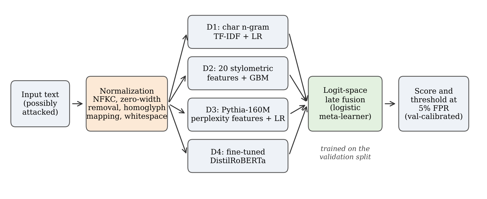

# Normalization-Aware Hybrid Fusion for Robust Detection of AI-Generated Text

Code and results for the paper:

> A. Katoch, "A Normalization-Aware Hybrid Fusion Framework for Robust Detection of AI-Generated Text" (under review).

## Overview
Four complementary detectors are combined through logistic late fusion, with a Unicode normalization defence in front:

| ID | Detector |
|----|----------|
| D1 | Character n-gram (3–5) TF-IDF + logistic regression |
| D2 | 20 stylometric features + gradient boosting |
| D3 | Perplexity / rank / entropy features from Pythia-160M + logistic regression |
| D4 | Fine-tuned DistilRoBERTa |
| Proposed | Normalization (NFKC, zero-width removal, homoglyph mapping, whitespace) + late fusion of D1–D4 |

## Main results (RAID sample, layout-flattened text)

| Detector | AUROC | TPR@5%FPR | Unseen-family AUROC (mean) |
|---|---|---|---|
| D1 TF-IDF + LR | 0.942 | 0.769 | 0.921 |
| D2 Stylometry + GBM | 0.941 | 0.767 | 0.924 |
| D3 Perplexity + LR | 0.901 | 0.697 | 0.858 |
| D4 DistilRoBERTa | 0.985 | 0.928 | 0.958 |
| **Proposed** | **0.991** | **0.960** | **0.978** |

Normalization restores DistilRoBERTa from 0.126 (homoglyph) and 0.025 (zero-width) TPR@5%FPR to 0.928.

**Note on RAID formatting:** human texts in RAID contain far fewer line breaks than machine texts (median 2 vs. 8). Two layout features alone reach AUROC 0.958. All results above use `flatten_layout=True`, which collapses all whitespace before training.

## How to run
1. Open `AIGT_Detection_RAID.ipynb` in Google Colab.
2. `Runtime → Change runtime type → T4 GPU`.
3. `Runtime → Run all` (about 90 minutes). RAID is downloaded automatically.
4. Results (tables, figures) are saved to `results_v2_flat.zip`.

Set `CFG["run_logo"] = False` to skip the leave-one-family-out experiment (about 30 minutes).

## Repository contents
- `AIGT_Detection_RAID.ipynb` – complete pipeline (data sampling, attacks, detectors, fusion, experiments E1–E4, figures)
- `data/sample_ids.csv` – RAID document IDs and train/val/test split used in the paper
- `results/tables/` – all result tables (CSV and LaTeX) and the run configuration
- `results/figures/` – figures used in the paper

## Data
RAID: Dugan et al., ACL 2024 – https://github.com/liamdugan/raid

## Contact
Amit Katoch, Assistant Professor, School of Computer Science and Engineering, IILM University, Greater Noida, India – amitkatoch2017@gmail.com

## License
MIT
